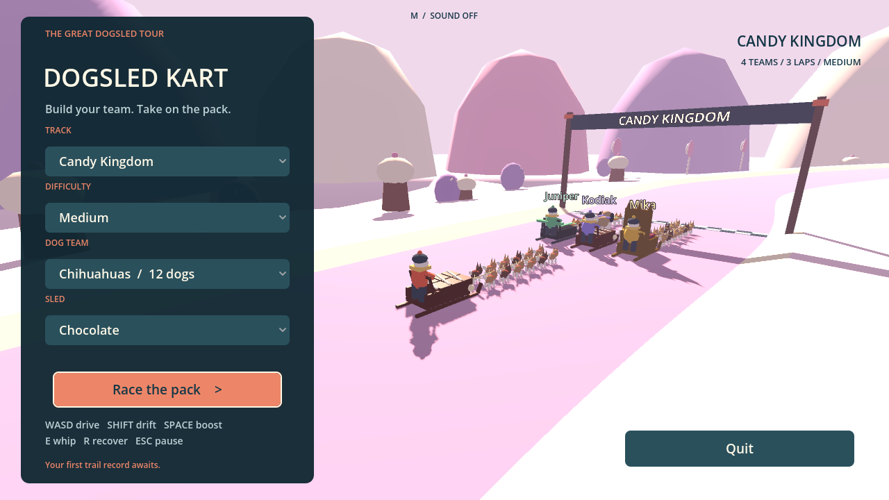

# Dogsled Kart

An offline 3D dogsled racer built in Godot. Race three NPC teams over three laps, bump rivals out of the way and build your own team.



## Play

Open `godot/project.godot` in Godot 4.6.3, press **F5**, choose your track, difficulty, dogs and sled, then **Race the pack**. On this Windows machine, you can also run:

```powershell
.\tools\run_game.ps1
```

The launcher checks PATH and Downloads; supply `-GodotPath 'C:\path\to\Godot.exe'` if needed. No external assets or manual scene setup are required.

## Tracks and garage

- **Alpine Valley:** the original snow trail, pines, cabins and frozen lake.
- **Jungle Rush:** a new winding route with palms, vines, a waterfall and temple.
- **Candy Kingdom:** a separate pastel course with lollipops, cupcakes and a frosted castle.

| Dog team | Dogs |
|---|---:|
| Huskies | 4 |
| Corgis | 8 |
| Mastiffs | 2 |
| Chihuahuas | 12 |

Each breed has its own proportions, colors and animated team layout. Sled choices are **standard wood**, **carbon racer**, **chocolate** and **king's throne**. Garage changes are visual and keep the same handling stats.

**Easy / Medium / Hard** changes trail width, off-track speed, rival pace and how often rivals attack. Choices persist between sessions, with separate personal records for each track and difficulty.

## Controls

| Action | Keyboard | Standard gamepad |
|---|---|---|
| Accelerate | W / Up | Right trigger |
| Brake, then reverse | S / Down | Left trigger |
| Steer | A / D or Left / Right | Left stick |
| Drift | Hold Shift while turning | Left shoulder |
| Mush boost | Space while accelerating | A |
| Whip nearby rival sleds | E | X |
| Recover to nearest trail (+3 seconds) | R | Y |
| Pause / resume | Esc | Start |
| Mute / unmute | M | Keyboard only |

Sleds physically bounce apart when they collide. Whips knock nearby sleds sideways, with a 3.5-second cooldown and brief protection after a hit. NPCs can attack too.

There are **no missed checkpoint gates to return to**. Continue around the route: forward progress around the course validates laps. Going off-track slows you sharply and disables boost. Recovery uses the nearest trail point. Repeatedly reversing across the finish line cannot earn laps.

## Racing rules

Juniper, Kodiak and Mika steer, brake for corners, choose passing lanes and boost on straights using the shared sled physics. There is no pace rubber-banding. Stuck rivals recover to the nearest trail point.

Places follow route progress and then finish-line crossing order. The finish table uses competition elapsed times; your personal time and saved record also include manual recovery penalties. Unfinished rivals keep racing after your results screen opens.

Records live in `user://alpine_time_trial_v1.cfg`, under `tour_v2_<course>_<difficulty>` sections. Older solo and pack records are preserved.

## Validation

```powershell
.\tools\test_game.ps1 -GodotPath 'C:\path\to\Godot_console.exe'
```

The runner imports the project, checks race states, continuous laps, off-track penalties, customization, saves, physical collisions and whips, then drives three laps on each course and runs NPC races at all nine course/difficulty combinations. Tests do not overwrite player records.

Generate previews with:

```text
Godot_console.exe --path godot --script res://tests/render_preview.gd
```

Current images are written to `artifacts/`. Keyboard, automated physics and rendered previews were checked locally. A physical gamepad and standalone Windows export still need testing.

## Where to work

Paths below are relative to `godot/`:

- `scripts/core/RaceCatalog.gd`: selections, team sizes and difficulty.
- `scripts/vehicle/SledTuning.gd`: handling and contact tuning.
- `scripts/vehicle/SledController.gd`: movement, collisions and whips.
- `scripts/vehicle/DogTeam.gd`, `SledStyles.gd`: procedural models.
- `scripts/track/AlpineTrack.gd`, `BiomeDecor.gd`: the three courses.
- `scripts/track/LapTracker.gd`: continuous route validation.
- `scripts/ai/RivalController.gd`: passing, cornering, boost and attacks.
- `scripts/ui/HUD.gd`: garage, race HUD, pause and results.

See [controls](docs/controls.md), [tuning](docs/tuning.md), [track building](docs/track_building.md) and [implementation history](IMPLEMENTATION_SUMMARY.md).
