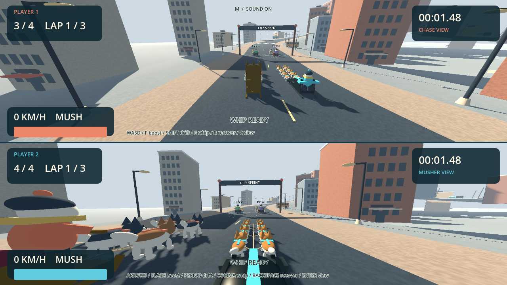

# Dogsled Kart

An offline 3D dogsled racer built in Godot. Race solo against three NPCs, or share a keyboard in local two-player split-screen against two NPCs. Build your own teams and race three laps.



## Play

Open `godot/project.godot` in Godot 4.6.3, press **F5**, choose your race mode, track, difficulty, dogs and sled, then **Race the pack**. On this Windows machine, you can also run:

```powershell
.\tools\run_game.ps1
```

The launcher checks PATH and Downloads; supply `-GodotPath 'C:\path\to\Godot.exe'` if needed. No external assets or manual scene setup are required.

**[Play in your browser](https://dogsledkart.cloud.run).** For Cloud Run setup, exports and updates, see [web deployment](docs/web-deployment.md).

**[Phone version](https://dogsledkart.cloud.run/mobile):** All four tracks, three difficulties, four dog breeds and four sleds. Hold your phone sideways and use the touch arrows. Acceleration is automatic; buttons cover boost, brake/reverse, drift and throwing a Golden Bone. Pause offers musher view, recovery, volume and sound. Tilt is disabled. Mobile settings and records are separate from desktop; shared-keyboard split-screen is on the desktop page. See [mobile testing](docs/mobile-testing.md).

## Tracks and garage

- **Alpine Valley:** snow trails, pines, cabins, a frozen lake and animated polar bears and arctic foxes.
- **Jungle Rush:** palms, vines, a waterfall, temple and ring-tailed lemurs and toucans.
- **Candy Kingdom:** spiral lollipops, cupcakes, gumdrops and a frosted castle and waving gingerbread spectators.
- **City Sprint:** rolling city streets, buses, buildings, streetlights and a clock tower and bobbing pigeons.

Every course now has stronger climbs and descents. Smoother meshes, finer surface grain and additional prop detail retain the colorful procedural style.

| Dog team | Dogs |
|---|---:|
| Huskies | 4 |
| Corgis | 8 |
| Mastiffs | 2 |
| Chihuahuas | 12 |

Each breed has its own anatomy, coat, ears, muzzle and animated team layout. Chihuahuas have apple-shaped heads, broad upright ears, short muzzles and fine legs. Sled choices are **standard wood**, **carbon racer**, **chocolate** and **king's throne**. Garage changes are visual and keep the same handling stats.

**Easy / Medium / Hard** changes trail width, off-track speed, rival pace and how often rivals attack. Choices persist between sessions, with separate personal records for each track and difficulty.

## Controls

| Action | Player 1 / solo | Player 2 |
|---|---|---|
| Drive | WASD | Arrow keys |
| Boost | F | Slash (/) |
| Drift | Shift | Period (.) |
| Throw Golden Bone | E | Comma (,) |
| Recover (+3 seconds) | R | Backspace |
| Chase / musher camera | C | Enter |
| Pause both | Esc | Esc |

**Space is unassigned to racing controls.** Solo mode also accepts arrows. M mutes and **-** / **+** change the volume. See [full controls and gamepad mappings](docs/controls.md).

The turbo meter shows the percentage of boost remaining. Hold F (Player 2: slash) to use turbo; release it to refill. Amber means 25% or less remains.

Musher view puts the dogs directly ahead. The throne's driver stands on a front platform. Each split-screen player switches views independently; Player 1 uses the top screen and Player 2 the bottom.

Sleds physically bounce apart when they collide. Collect one of just **three Golden Bones** per track, then throw it near an opponent to lure their dogs off-track for one second. Aim carefully: the pickup radius is 1.9375 m. Each racer holds one item; pickups respawn, and distracted teams get protection against repeated hits. NPCs collect and throw bones too.

Watch the roadside warning signs: bears and buses cross the trail, lemurs lob coconuts (a hit stops your team for one second), and falling lollipops cover less than half the road. All obstacle hits pause the team for one second, then allow it to drive through without backing up. Alpine Valley also has rolling snowballs. Coconut landing rings show where to dodge. Hazards affect NPCs too, and they consider obstacles when choosing a lane.

Each track has an original looping score: a melody stem with bass and chords, plus a synchronised drum stem that swells with speed, boosting and the final lap, over a per-biome ambience bed. Effects have several variants and slight pitch shifts so they do not repeat. Crashes and coconuts layer CC0 impacts; menu clicks and dog barks and howls are CC0 recordings (see [credits](godot/assets/audio/CREDITS.md)). Your sled has quiet speed-reactive runner, drift-scrape and off-track crunch loops, and your dogs pant, bark, yip and howl, with pitch by breed and bigger choruses for bigger teams. Rivals are positional: their runners, boosts, bumps and throws pan and fade with distance. In two-player races each player's own sounds sit on their side of the stereo field. M mutes everything and **-** / **+** step the single shared volume in 10% increments; it is saved with your other preferences.

There are **no missed checkpoint gates to return to**. Continue around the route: forward progress around the course validates laps. The first off-track cut is 6 m wide and slows you gently. The next 8 m progressively reduce your speed further. Boost is disabled off-track. Recovery uses the nearest trail point. Repeatedly reversing across the finish line cannot earn laps.

## Racing rules

Juniper, Kodiak and Mika steer, brake for corners, choose passing lanes and boost on straights using the shared sled physics. There is no pace rubber-banding. Stuck rivals recover to the nearest trail point.

Places follow route progress and then finish-line crossing order. The finish table uses competition elapsed times; your personal time and saved record also include manual recovery penalties. Solo results resolve immediately: unfinished rivals receive times projected from their average pace and remaining distance, marked **est.**, preserving their current order. Actual finishes stay unchanged. In local duels, the first human finisher waits while the other keeps racing; results appear after both finish. Recovery penalties, clocks, lap counters and garage selections are independent for each player.

NPC target cruising pace is 25% higher across Easy, Medium and Hard, with shorter boost and throw cooldowns. Records live in `user://alpine_time_trial_v1.cfg`, under `tour_v5_<course>_<difficulty>` sections for the new hazard rules. Earlier records are preserved. Local duels do not overwrite solo records.

## Validation

```powershell
.\tools\test_game.ps1 -GodotPath 'C:\path\to\Godot_console.exe'
```

The runner imports the project, checks race states, continuous laps, off-track penalties, customization, saves, physical collisions and Golden Bone pickups/throws, plus separate player inputs, cameras, pause, recovery and finish order. It drives three laps in solo and local two-player modes on every course and runs NPC races at all twelve course/difficulty combinations. Tests do not overwrite player records.

Generate previews with:

```text
Godot_console.exe --path godot --script res://tests/render_update.gd
```

Current images are written to `artifacts/`. Keyboard, automated physics and rendered previews were checked locally. A physical gamepad and standalone Windows export still need testing.

## Where to work

Paths below are relative to `godot/`:

- `scripts/core/RaceCatalog.gd`: selections, team sizes and difficulty.
- `scripts/vehicle/SledTuning.gd`: handling and contact tuning.
- `scripts/vehicle/SledController.gd`: movement, collisions and Golden Bone pickups/throws.
- `scripts/vehicle/DogTeam.gd`, `DogModels.gd`, `SledStyles.gd`: procedural models.
- `scripts/core/RaceItems.gd`: Golden Bone pickups, throws and respawning.
- `scripts/track/AlpineTrack.gd`, `BiomeDecor.gd`: the four courses.
- `scripts/track/CityDecor.gd`, `TrackLife.gd`: city scenery and roadside characters.
- `scripts/camera/ChaseCamera.gd`, `SplitScreen.gd`: chase/POV and shared-world split-screen.
- `scripts/track/LapTracker.gd`: continuous route validation.
- `scripts/ai/RivalController.gd`: passing, cornering, boost and attacks.
- `scripts/ui/HUD.gd`: garage, race HUD, pause and results.

See [controls](docs/controls.md), [tuning](docs/tuning.md), [track building](docs/track_building.md) and [implementation history](IMPLEMENTATION_SUMMARY.md).
