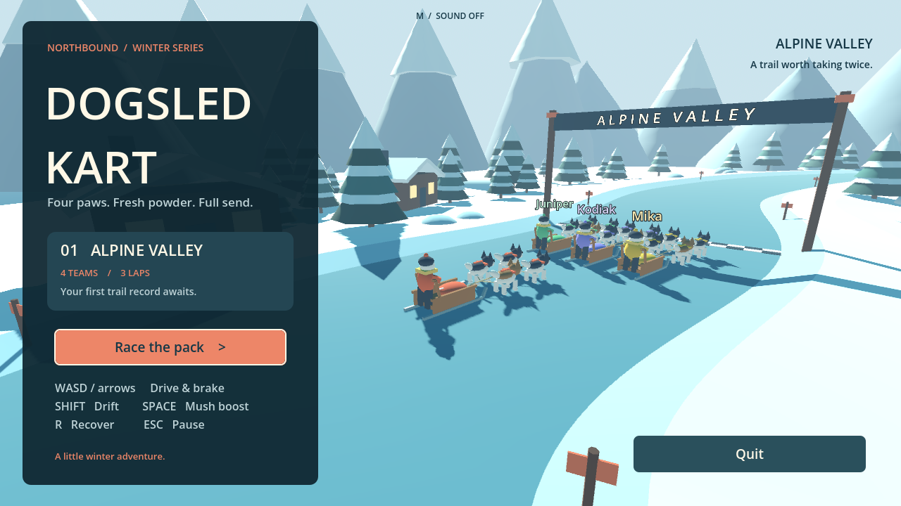

# Dogsled Kart

A small, offline 3D dogsled racer built in Godot. Race **three NPC dog teams over three laps of Alpine Valley** with an original, procedural low-poly winter world.



## Play

1. Open `godot/project.godot` in Godot 4.6 (tested with **4.6.3**).
2. Press **F5**, then **Race the pack**.
3. Complete three laps, crossing the start line and following the trail through every marker.

No autoload configuration, scene creation, downloads, or external art assets are needed.

On this Windows machine, you can also run:

```powershell
.\tools\run_game.ps1
```

The launcher checks PATH and the user's Downloads folder. You can supply `-GodotPath 'C:\path\to\Godot.exe'` explicitly.

## Controls

| Action | Keyboard | Standard gamepad mapping |
|---|---|---|
| Accelerate | W / Up | Right trigger |
| Brake, then reverse | S / Down | Left trigger |
| Steer | A / D or Left / Right | Left stick |
| Drift | Hold Shift while turning | Left shoulder |
| Mush boost | Hold Space while accelerating | A |
| Recover to last valid marker (+3 seconds) | R | Y |
| Pause / resume | Esc | Start |
| Mute / unmute | M | Keyboard only |
| Menus | Mouse, or arrows and Enter | D-pad and confirm |

Keyboard and automated input were tested locally. Physical gamepad behavior still needs a hardware playtest.

## What's playable

- Four articulated huskies, harness lines, a wooden sled and a bundled-up musher for every team.
- Three autonomous rivals: Juniper (green, steady), Kodiak (purple, balanced), and Mika (gold, fast).
- Shared driving physics, corner-aware steering, passing lanes and timed boosts.
- Live race position, four-team leaderboard, colored minimap dots and finish order.
- A winding, gently elevated snow trail, pine forest, cabins, frozen tarn and mountain backdrop.
- Momentum-based steering, controllable sliding, off-trail slowdown, rechargeable boost and recovery.
- Countdown, validated directional checkpoints, three full laps, pause, results, lap splits and instant retry.
- Speed-responsive chase camera, snow spray, runner noise, boost bark and timing cues.
- Offline personal-best race and lap times saved in the `alpine_pack` section of `user://alpine_time_trial_v1.cfg`; original solo records are preserved.
- Menus, HUD and minimap rendered at a scalable 1280x720 base resolution.
- Compatibility renderer for a lightweight starting point.

## Validation

```powershell
.\tools\test_game.ps1 -GodotPath 'C:\path\to\Godot_console.exe'
```

The smoke suite checks physical movement and real checkpoint entry, race states, lap ordering, recovery, boost, finish/restart and persistence using an isolated disposable save. The steering test drives three full laps through the actual physics and triggers, without teleporting or writing player records. The NPC suite also tests all three rivals finishing, pause/restart, checkpoint isolation, start-line ranking, a player victory, and rivals finishing after the results screen opens.

Render current previews:

```text
Godot_console.exe --path godot --script res://tests/render_preview.gd
```

Images are written to `artifacts/`.

## Where to work

- `scripts/vehicle/SledTuning.gd`: movement and camera tuning.
- `scripts/vehicle/SledController.gd`: input, momentum, drift and boost.
- `scripts/vehicle/DogTeam.gd`: procedural models and animation.
- `scripts/track/AlpineTrack.gd`: one spline drives terrain, checkpoints and minimap.
- `scripts/core/RaceManager.gd`: race lifecycle.
- `scripts/ui/HUD.gd`: basecamp, HUD, pause and results.
- `tests/`: repeatable smoke, driving and render checks.

Paths above are relative to `godot/`. See [implementation notes](IMPLEMENTATION_SUMMARY.md), [controls](docs/controls.md), [tuning](docs/tuning.md) and [track building](docs/track_building.md).

## Still ahead

Items, more courses, achievement progression, music, higher-detail art and a standalone Windows export are not part of this milestone. The original design and older feature proposals are retained as historical context; they are not a list of shipped features.

## Competition rules

Places are determined by validated lap progress and finish-line crossing order. Rivals follow the same checkpoint sequence as you and do not receive catch-up teleports. They can recover backward to their last valid marker if stuck. Team-to-team contact is forgiving: sleds do not physically block one another, while NPCs steer aside to pass.

The results table shows competition elapsed times. Your large personal time and saved record also include the existing +3 seconds for each manual recovery. Recovery does not reorder teams that have already finished. Rivals still on the trail keep racing while the results screen is open; unfinished rows say **Racing...** until they cross the line.
